<a href="https://stevesojan.vercel.app">
  <picture>
    <source media="(prefers-color-scheme: dark)" srcset="assets/header-dark.svg">
    
  </picture>
</a>

  <a href="https://stevesojan.vercel.app"><picture><source media="(prefers-color-scheme: dark)" srcset="assets/btn-portfolio-dark.svg"></picture></a>
  <a href="https://stevesojan.vercel.app/resume"><picture><source media="(prefers-color-scheme: dark)" srcset="assets/btn-resume-dark.svg"></picture></a>
  <a href="https://www.linkedin.com/in/steve-sojan"><picture><source media="(prefers-color-scheme: dark)" srcset="assets/btn-linkedin-dark.svg"></picture></a>
  <a href="mailto:stevesojan9@gmail.com"><picture><source media="(prefers-color-scheme: dark)" srcset="assets/btn-email-dark.svg"></picture></a>
  <a href="https://kaggle.com/stevesojan"><picture><source media="(prefers-color-scheme: dark)" srcset="assets/btn-kaggle-dark.svg"></picture></a>
  <a href="https://gitlab.com/stevesojan9"><picture><source media="(prefers-color-scheme: dark)" srcset="assets/btn-gitlab-dark.svg"></picture></a>

Software Design Engineer II at **Newgen Software** (NumberTheory AI division), integrating machine-learning and data-science workflows into production software. Previously a Data Science Intern at **Sony Research India** and a semester-long intern at **IIT Bombay** (FOSSEE · Osdag). B.Tech in Computer Science with a minor in AI & ML from **VIT**.

My work spans models and systems: fine-tuning foundation models, rethinking architectures, and building the low-latency software that runs them.

### Selected work

  <a href="https://github.com/stevesojan/limit-order-book"><picture><source media="(prefers-color-scheme: dark)" srcset="assets/card-lob-dark.svg"></picture></a>
  <a href="https://github.com/stevesojan/tabpfn-lora"><picture><source media="(prefers-color-scheme: dark)" srcset="assets/card-lora-dark.svg"></picture></a>

  <a href="https://github.com/stevesojan/Transformer-KAN"><picture><source media="(prefers-color-scheme: dark)" srcset="assets/card-kan-dark.svg"></picture></a>
  <a href="https://gitlab.com/workhorse4/workhorse-ai"><picture><source media="(prefers-color-scheme: dark)" srcset="assets/card-workhorse-dark.svg"></picture></a>

  <a href="https://github.com/stevesojan/4sight"><picture><source media="(prefers-color-scheme: dark)" srcset="assets/card-foursight-dark.svg"></picture></a>
  <a href="https://github.com/stevesojan/zelestra_challenge"><picture><source media="(prefers-color-scheme: dark)" srcset="assets/card-zelestra-dark.svg"></picture></a>

Each card opens its repository. The interactive architecture of every project is on the <a href="https://stevesojan.vercel.app/#projects">portfolio</a>.

### Toolkit

<picture>
  <source media="(prefers-color-scheme: dark)" srcset="assets/toolkit-dark.svg">
  
</picture>

### Experience

| | Role | When |
|---|---|---|
| **Newgen Software** · NumberTheory AI | Software Design Engineer II | Jul 2026 – present |
| **Sony Research India** | Data Science Intern | Dec 2025 – Mar 2026 |
| **IIT Bombay** · FOSSEE, Osdag | Semester Long Intern · [final report](https://static.fossee.in/fossee/reports-2025/semester_long_internship/FOSSEE_Fellowship_Report___Steve_Sojan%20-%20Steve%20Sojan.pdf) | Feb – Jun 2025 |

### Research notes

<b>Transformer-KAN</b>: learnable splines instead of MLP blocks

 

The feed-forward sublayer of each Transformer block is replaced by a Kolmogorov–Arnold Network: every connection learns its own univariate spline instead of a fixed weight followed by a fixed activation.

$$\mathrm{FFN}(x) = \sigma(xW_1 + b_1)\,W_2 + b_2 \qquad\longrightarrow\qquad \mathrm{KAN}(x) = \sum_{i=1}^{m} \varphi_i\Big(\sum_{j=1}^{d} \psi_{ij}(x_j)\Big)$$

| Model (Tiny Shakespeare, test) | Loss ↓ | Perplexity ↓ | Accuracy ↑ |
|---|---|---|---|
| Transformer (MLP) | 0.0311 | 1.0316 | 99.16% |
| **Transformer-KAN** | **0.0233** | **1.0236** | **99.38%** |

[Code →](https://github.com/stevesojan/Transformer-KAN)

<b>TabPFN-LoRA</b>: adapting a tabular foundation model without retraining it

 

Low-rank adapters are injected into the query/key/value projection of every attention layer while the pretrained backbone stays frozen. `B` starts at zero, so training begins from the unchanged foundation model.

$$W'_{qkv} = W_{qkv} + \frac{\alpha}{r}\,BA, \qquad B \in \mathbb{R}^{d\times r},\; A \in \mathbb{R}^{r\times k}$$

Used to improve accuracy on a proprietary 30M+ row tabular dataset without expensive end-to-end retraining. [Code →](https://github.com/stevesojan/tabpfn-lora)

 

The full interactive blueprint lives at <a href="https://stevesojan.vercel.app">stevesojan.vercel.app</a>

